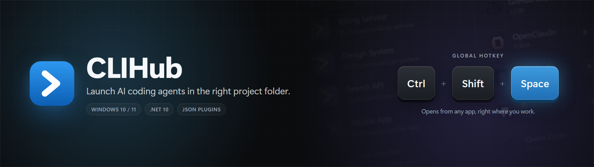
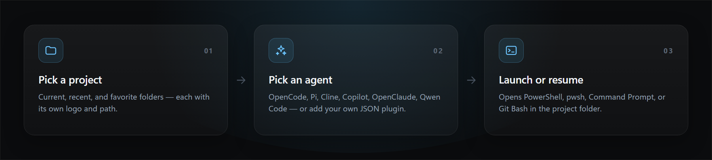
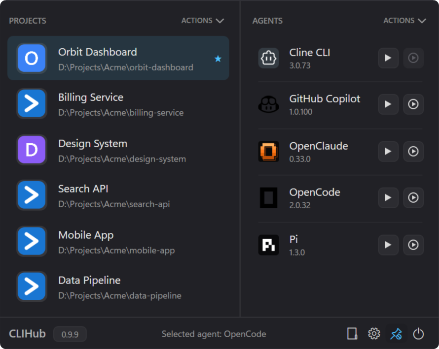
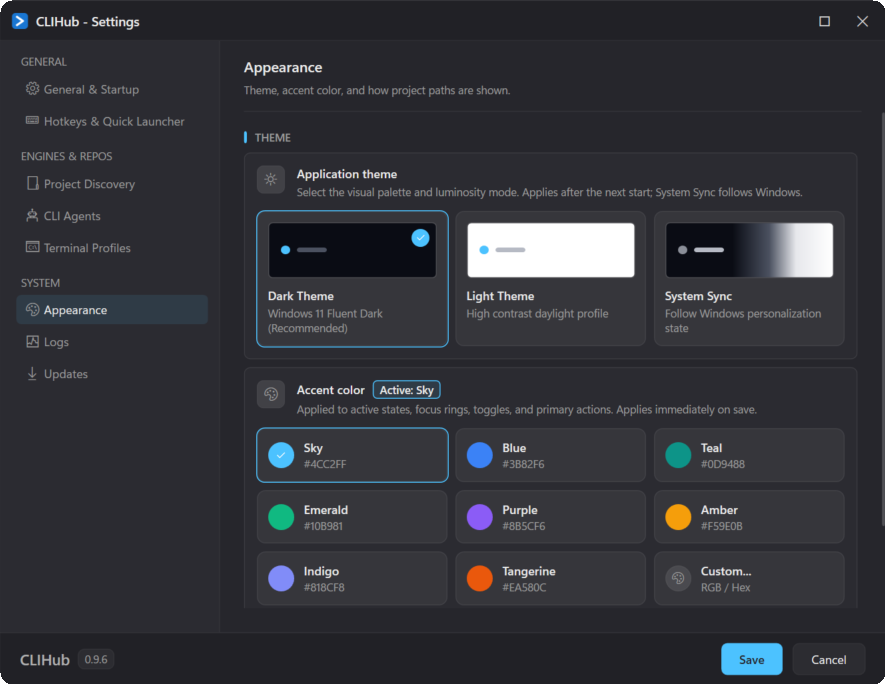

<div align="center">
  
</div>

# CLIHub

<p>
  <a href="https://github.com/trustsoft/CLIHub/actions/workflows/ci.yml"></a>
  <a href="https://github.com/trustsoft/CLIHub/releases"></a>
  
  
</p>

**CLIHub is a Windows system-tray companion for launching AI agent CLIs in the context of the current
project.** It keeps your project folders, detects the agent CLIs installed on your machine, and opens the one
you pick in an external terminal — in the right directory, with the right command.

Built-in descriptors cover OpenCode, Pi, Cline CLI, GitHub Copilot, OpenClaude, and Qwen Code; additional
agents can be added as JSON plugins.

## How it works



CLIHub is deliberately small: it stores your projects and detects which agents are available, then runs the
chosen command in the terminal you already use. Agents are not embedded, proxied, or executed in-process.

## Screenshots



*The launch window: select a project on the left, then launch or resume an installed agent on the right.*



*Settings: theme, accent color, hotkeys, terminal runtime, agent probes, project discovery, updates, and logs.*

## Features

- Project folders with current, recent, favorite, and logo-aware state.
- Automatic project discovery: watch folders, scan them with per-folder depth and rules, and keep new repositories in the project list.
- Agent commands for launch, resume, version, and update.
- Host/project availability detection, version display, and capability-aware actions.
- Global hotkey (`Ctrl+Shift+Space` by default) and a single-instance tray application.
- PowerShell, PowerShell 7, Command Prompt, and Git Bash runtime selection.
- Chromeless resizable launch window, Settings, and What's New windows with a shared Dark/Light/Blue theme and a
  system-synced option that follows the Windows light/dark personalization setting.
- Startup update checks, download-and-restart updates, release notes, and Windows autostart.
- Agent update protection while a matching registered agent process is running.
- Structured file logging with configurable level and seven-day retention.

## Requirements

- Windows 10 or 11.
- .NET 10 Desktop Runtime (x64) for installed builds; the installer can bootstrap it.
- [.NET 10 SDK](https://dotnet.microsoft.com/download/dotnet/10.0) to build the repository.
- An interactive shell for agent commands: PowerShell (the built-in default), PowerShell 7,
  Command Prompt, or Git Bash.

## Build and Run

```powershell
dotnet build CLIHub.sln
dotnet test CLIHub.sln
dotnet run --project src/CLIHub/CLIHub.csproj
```

## Basic Use

1. Open CLIHub from the tray icon or press `Ctrl+Shift+Space`.
2. Add a project folder and select it, or let CLIHub discover folders under a watched root in Settings → Project Discovery.
3. Select an available agent and run the required command.
4. Configure runtime, hotkey, probing, update checks, display preferences, and project discovery in Settings.
5. Close running registered agents before using an Update command; CLIHub keeps the action disabled while
   a matching process is detected.

## Data and Plugins

User data is stored under `%APPDATA%\CLIHub\` (`config.json`, `logs\`, `plugins\`, and `cache\`). The
configuration is one camelCase JSON document. Plugins are descriptor folders:

```text
%APPDATA%\CLIHub\plugins\<id>\plugin.json
```

Minimal descriptor:

```jsonc
{
  "id": "my-agent",
  "name": "My Agent",
  "commands": {
    "launch": { "executable": "my-agent" },
    "version": { "executable": "my-agent", "arguments": "--version" }
  },
  "detection": {
    "systemPaths": [ "%USERPROFILE%\\.my-agent" ],
    "projectIndicators": [ ".my-agent" ]
  }
}
```

Only `launch` is required. The complete descriptor contract is in
[`docs/architecture/plugins.md`](docs/architecture/plugins.md).

## Releases

CI builds and tests pull requests and pushes to `master`. A `v*` tag starts the Windows packaging and GitHub
Release workflow. Maintainers should follow [`docs/releasing.md`](docs/releasing.md).

## Repository Map

```text
src/CLIHub.Core/       # UI-independent Core logic
src/CLIHub.Core.Windows/ # Windows platform adapters
src/CLIHub/            # WPF application
tests/CLIHub.Core.Tests/
tests/CLIHub.Core.Windows.Tests/
tests/CLIHub.Tests/
docs/                  # current project and architecture documentation
openspec/specs/        # durable behavior contracts
```

For agent-oriented project context, read [`docs/project-context.md`](docs/project-context.md). The full
documentation map is in [`AGENTS.md`](AGENTS.md); historical changes live under
[`openspec/changes/archive/`](openspec/changes/archive/).
